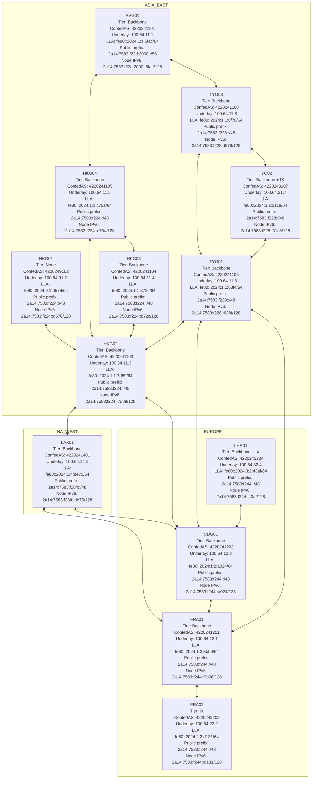

The node values above are derived from the current `node.yml` files and the
addressing filters. In particular, the LLA uses the node token as its final
16-bit field; it is not derived from `node_id`.

Edges represent configured `intra.auto_confed_peers` sessions (WireGuard plus
intra BGP), rather than physical circuits. LHR01 currently has one intra
connection, directly to CDG01.
